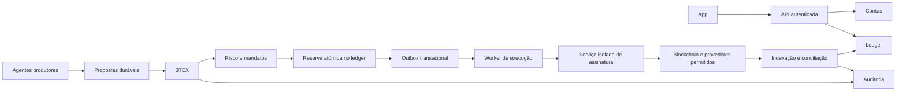

# Arquitetura de desenvolvimento

Documento de apoio. O mapa normativo, dependências e fontes de verdade estão em [docs/architecture.md](../architecture.md); decisões canônicas em [docs/decisions](../decisions/README.md). Consultar e atualizar essas fontes antes de evoluir os contextos.

## Estado efetivo e objetivo

O sistema atual é um monorepo com interface React/Vite, API Express, Clerk e PostgreSQL/Drizzle. Identidade e persistência são reais. A execução financeira é emulada e usa estados JSONB e números JavaScript. **Este backend ainda não é a infraestrutura financeira de produção.**

A arquitetura-alvo separa responsabilidades antes de multiplicar processos. As fronteiras abaixo são o padrão para novas implementações; a migração completa do código existente ainda não foi feita.

## Contextos e propriedade

O mapa único de módulos, responsabilidades, dados e dependências é mantido em [docs/architecture.md](../architecture.md). BTEX pertence à coordenação de agentes; risco/tesouraria autorizam; execução e assinatura permanecem distintos. Não criar mapas concorrentes neste documento de apoio.

## Fluxo-alvo



Diagrama da arquitetura-alvo, não de serviços já implantados. Agentes de mercados externos também podem executar por APIs autorizadas; não se deve forçar toda operação a virar transação blockchain.

## Estrutura de código-alvo

```text
artifacts/api-server/src/modules/<contexto>/
  domain/          entidades, invariantes, estados e políticas puras
  application/     casos de uso e portas de integração
  infrastructure/  repositórios, filas e adaptadores concretos
  transport/       endpoints e mapeamento dos contratos
lib/contracts/     contratos versionados de eventos, quando implementados
artifacts/<worker-ou-servico>/  somente quando houver isolamento justificado
```

Essa árvore é proposta. Não criar módulos vazios nem copiar o motor demonstrativo para chamá-lo de ledger. `lib/api-spec` permanece a fonte dos contratos HTTP; tipos/validadores gerados continuam nas bibliotecas existentes.

## Microsserviços e execução

- Primeiro implementar os contextos como módulos testáveis no backend existente, preservando banco e rotas atuais.
- Antes de assinar transações reais, isolar assinatura em serviço, credenciais e permissões próprios.
- Extrair workers de agentes, execução e indexação quando exigido por segurança, disponibilidade ou carga medida.
- Não compartilhar escritas nas tabelas de outro serviço. Migração para serviços exige contratos, autenticação serviço-a-serviço, timeouts, observabilidade, outbox e consumidores idempotentes.
- Não prometer entrega “exatamente uma vez”: usar entrega ao menos uma vez, deduplicação e conciliação.
- O temporizador demonstrativo atual não substitui fila durável nem agendamento financeiro resiliente.
- No Replit, avaliar Reserved VM para workers persistentes; Autoscale atende APIs/web. Serviços com implantação independente exigem planejamento próprio de projetos. Isso é recomendação, não configuração realizada.

Referências da plataforma: [tipos de publicação](https://docs.replit.com/features/publishing/deployment-types) e [projetos/artifacts](https://docs.replit.com/features/projects-and-artifacts/multiple-artifacts-vs-projects).

## Contratos e precisão

HTTP é contract-first. Eventos precisam de `eventId`, tipo/versão, agregado/versão, identidade do emissor, `correlationId`, `causationId`, instante UTC e referência ao mandato/decisão quando aplicável. O consumidor valida origem, schema e autorização.

Quantias financeiras são unidades inteiras, serializadas como strings, com ativo, rede, contrato e escala validados. Preços/taxas usam aritmética decimal e regras explícitas de arredondamento; nunca `number` no núcleo financeiro de produção.

Reserva, lançamento e evento outbox são gravados na mesma transação. Duplicidade com o mesmo comando não lança de novo; mesma chave com outro payload é erro. Estado de execução incerta mantém a reserva e aguarda conciliação.

## Invariantes de negócio preservadas

- Fundos pessoais, recursos da tesouraria, obrigações e resultados são distintos.
- Política aprovada pela liderança da Fundação permite operações dentro do mandato sem aprovação humana de cada ordem.
- O split aplica-se ao lucro líquido distribuível, com reservas, custos, obrigações e condições de pagamento atendidos; não ao capital.
- Rodadas são independentes: pagam ou não pagam, sem acumular direito para outra rodada.
- Saídas cancelam direitos conforme a regra aprovada; frações não distribuídas seguem para tesouraria.
- Cortes financeiros não mudam por localização da interface: exibir São Paulo, preservar instantes internos.
- Estimativa de um agente não é lucro realizado, confiança calibrada ou prova de execução.

## Observabilidade e recuperação

Logs estruturados sem segredos/PII desnecessária; correlação entre proposta, decisão, reserva, execução e conciliação. Métricas de idade da fila, exposição, falhas, execuções incertas, divergência de saldo e atraso de conciliação. Alertas, responsável operacional, revogação de mandato, interrupção segura, replay idempotente e teste de restauração são requisitos anteriores à operação real.

## Ordem de implementação e gates

1. **Base de engenharia:** revisão, regras, CI e regressões da demonstração. Entregue nesta organização; não equivale a migrar domínios.
2. **Dados/identidade:** módulos e testes de propriedade, concorrência, reinício, idempotência e histórico durável. Migrações versionadas.
3. **Ledger/tesouraria:** partidas dobradas, precisão, reservas e outbox; invariantes verificadas com falhas e concorrência.
4. **Carteira/assinatura:** decisão de custódia/exportação/recuperação aprovada e isolamento de assinatura.
5. **Integrações controladas:** dados reais e adaptadores, começando sem movimentar fundos; proposta nunca é ordem.
6. **Ambiente de teste financeiro:** execução, confirmações, reorganizações, conciliação, interrupção e restauração.
7. **Produção:** revisões independentes, mandatos e validações aplicáveis; autorização explícita. Nenhum flag de interface elimina esses gates.