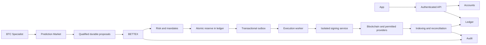

# Development Architecture

Supporting document. The normative map, dependencies, and sources of truth are in [docs/architecture.md](../architecture.md); canonical decisions are in [docs/decisions](../decisions/README.md). Consult and update these sources before evolving contexts.

## Effective and objective state

The current system is a monorepo with a React/Vite interface, Express API, Clerk, and PostgreSQL/Drizzle. Identity and persistence are real. Financial execution is emulated and uses JSONB states and JavaScript numbers. **This backend is not yet the production financial infrastructure.**

The target architecture separates responsibilities before multiplying processes. The boundaries below are the standard for new implementations; the complete migration of existing code has not yet been performed.

## Contexts and ownership

The unique map of modules, responsibilities, data, and dependencies is maintained in [docs/architecture.md](../architecture.md). BETTEX coordinates and selects; the BTC specialist delivers to the Prediction Market, which validates and forwards to BETTEX. Risk/treasury authorize; execution and signing remain distinct. See [hierarchy](../agent-hierarchy.md). Do not create competing maps in this supporting document.

## Target flow



Diagram of the target architecture, not of services already deployed. External market agents can also execute via authorized APIs; one should not force every operation to become a blockchain transaction.

## Target code structure

```text
artifacts/api-server/src/modules/<context>/
  domain/          entities, invariants, states and pure policies
  application/     use cases and integration ports
  infrastructure/  repositories, queues and concrete adapters
  transport/       endpoints and contract mapping
lib/contracts/     versioned event contracts, when implemented
artifacts/<worker-or-service>/  only when justified isolation exists
```

This tree is a proposal. Do not create empty modules or copy the demonstration engine to call it a ledger. `lib/api-spec` remains the source of HTTP contracts; generated types/validators continue in the existing libraries.

## Microservices and execution

- First, implement contexts as testable modules in the existing backend, preserving the current database and routes.
- Before signing real transactions, isolate signing in its own service, credentials, and permissions.
- Extract agent workers, execution, and indexing when required by security, availability, or measured load.
- Do not share writes on another service's tables. Migration to services requires contracts, service-to-service authentication, timeouts, observability, outbox, and idempotent consumers.
- Do not promise "exactly once" delivery: use at-least-once delivery, deduplication, and reconciliation.
- The current demonstration timer does not replace a durable queue or resilient financial scheduling.
- In Replit, evaluate Reserved VM for persistent workers; Autoscale serves APIs/web. Services with independent deployment require their own project planning. This is a recommendation, not a performed configuration.

Platform references: [deployment types](https://docs.replit.com/features/publishing/deployment-types) and [projects/artifacts](https://docs.replit.com/features/projects-and-artifacts/multiple-artifacts-vs-projects).

## Contracts and precision

HTTP is contract-first. Events need an `eventId`, type/version, aggregate/version, issuer identity, `correlationId`, `causationId`, UTC timestamp, and a reference to the mandate/decision when applicable. The consumer validates origin, schema, and authorization.

Financial amounts are integer units, serialized as strings, with asset, network, contract, and scale validated. Prices/rates use decimal arithmetic and explicit rounding rules; never `number` in the production financial core.

Reserve, release, and outbox event are recorded in the same transaction. Duplicity with the same command does not launch again; the same key with another payload is an error. Uncertain execution state maintains the reserve and awaits reconciliation.

## Preserved business invariants

- Personal funds, treasury resources, obligations, and results are distinct.
- Policy approved by the Foundation leadership allows operations within the mandate without human approval of each order.
- The split applies to distributable net profit, with reserves, costs, obligations, and payment conditions met; not to capital.
- Rounds are independent: they pay or do not pay, without accumulating rights for another round.
- Exits cancel rights according to the approved rule; undistributed fractions go to the treasury.
- Financial cuts do not change based on interface location: display São Paulo, preserve internal timestamps.
- An agent's estimate is not realized profit, calibrated confidence, or proof of execution.

## Observability and recovery

Structured logs without unnecessary secrets/PII; correlation between proposal, decision, reserve, execution, and reconciliation. Metrics for queue age, exposure, failures, uncertain executions, balance divergence, and reconciliation delay. Alerts, operational responsible, mandate revocation, safe interruption, idempotent replay, and restoration testing are requirements prior to real operation.

## Implementation order and gates

1. **Engineering base:** review, rules, CI, and demonstration regressions. Delivered in this organization; does not equate to migrating domains.
2. **Data/identity:** modules and tests for ownership, concurrency, restart, idempotency, and durable history. Versioned migrations.
3. **Ledger/treasury:** double-entry bookkeeping, precision, reserves, and outbox; invariants verified with failures and concurrency.
4. **Wallet/signing:** approved custody/export/recovery decision and signing isolation.
5. **Controlled integrations:** real data and adapters, starting without moving funds; a proposal is never an order.
6. **Financial test environment:** execution, confirmations, reorganizations, reconciliation, interruption, and restoration.
7. **Production:** independent reviews, mandates, and applicable validations; explicit authorization. No interface flag eliminates these gates.
